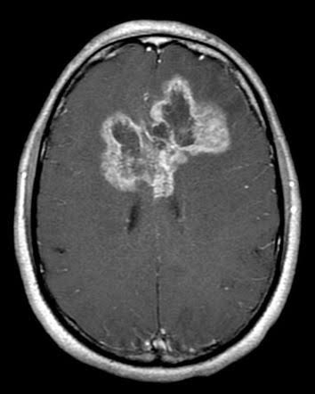
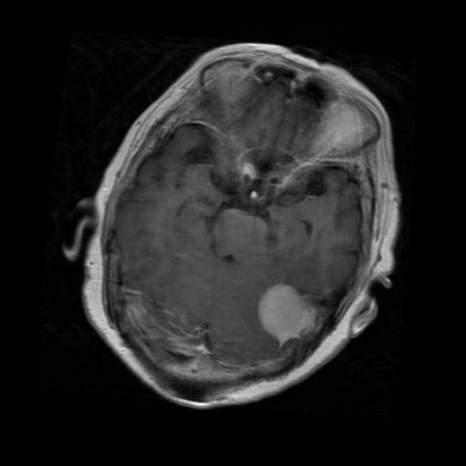
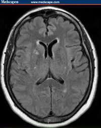
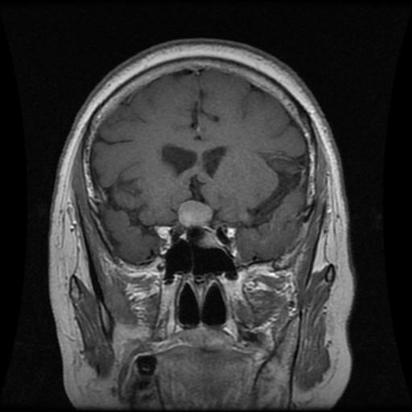

# 🧠 Brain Tumor MRI Classifier

[](https://brain-tumor-mri-classifier-kcepq4kwdkr6qza5i4qdwm.streamlit.app/)

Upload a brain MRI scan and get an instant prediction, with confidence scores, for one of four classes:

| Glioma | Meningioma | No Tumor | Pituitary Tumor |
|:---:|:---:|:---:|:---:|
|  |  |  |  |

**👉 [Try the live app](https://brain-tumor-mri-classifier-kcepq4kwdkr6qza5i4qdwm.streamlit.app/)**

## How it works

- **Model:** MobileNetV2 convolutional network fine-tuned with transfer learning
- **Input:** 224×224 RGB images, with augmentation during training (flip, rotation, zoom, contrast)
- **Head:** global average pooling → dropout → dense(128, ReLU) → dropout → 4-way softmax
- **Test accuracy:** ~83%
- **Dataset:** [Brain Tumor MRI Dataset (Kaggle)](https://www.kaggle.com/datasets/masoudnickparvar/brain-tumor-mri-dataset)
- **Training notebook:** [school/…/MRI_Classification-Project](https://github.com/kembaoak/school/tree/main/DATA5100-Foundations/Data-Science-Projects/MRI_Classification-Project)

## Tech stack

Python 3.11 · TensorFlow / Keras · Streamlit · NumPy · Pillow

## Run locally

```bash
git clone https://github.com/kembaoak/brain-tumor-mri-classifier.git
cd brain-tumor-mri-classifier
pip install -r requirements.txt
streamlit run app.py
```

## Disclaimer

This project is for educational and research purposes only. It is **not** a medical diagnostic tool.
